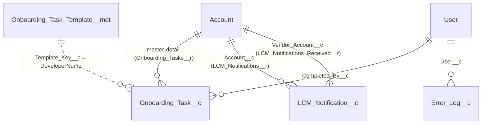

# Data model

| Object | Owner (module / framework) | Notes |
|---|---|---|
| Account (record types Customer, Partner, Internal; Account_Status__c, Email__c) | shared Account model | Internal = vendor accounts |
| Account onboarding fields (Onboarding_Tasks_Total/Completed__c, Onboarding_Progress__c, Onboarding_Completed_Date__c) | onboarding | Roll-ups over Onboarding_Task__c |
| Account field set LCM_Notification_Fields | lifecycle-management | Email content |
| Onboarding_Task__c | onboarding | Controlled by parent |
| Onboarding_Task_Template__mdt | onboarding | 6 records |
| LCM_Notification__c | lifecycle-management | Audit of vendor notifications |
| Error_Log__c, Error_Log_Event__e | exception framework | Platform event → log record |
| Trigger_Setting__mdt | trigger framework | Handler on/off switch |

Permission sets: Application_Logger (everyone), Error_Log_Admin, Trigger_Bypass (data loads),
Onboarding_Manager, LCM_User.
All objects live in force-app/main/default; ownership is by name (see .claude/CLAUDE.md).
